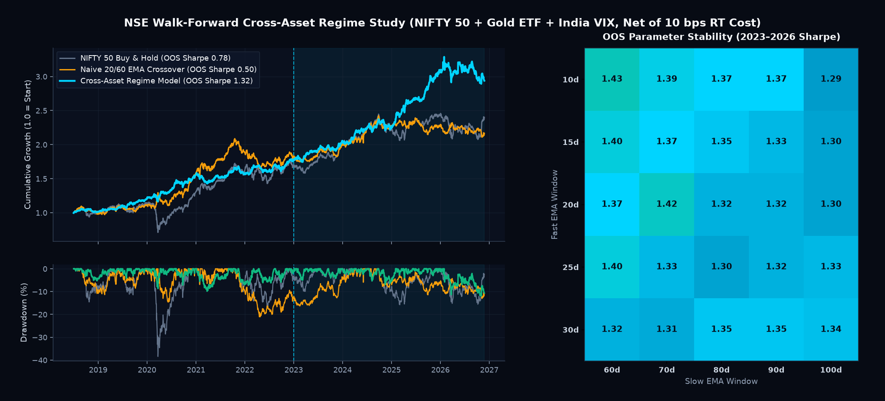

# Walk-Forward NSE Cross-Asset Regime & Volatility-Parity Research

**Candidate:** Sunil Parswal — IDD Civil Engineering, IIT (BHU) Varanasi (Class of 2027)  
**Target Role:** Junior Quantitative Research Analyst — House of EdTech  
**Contact:** `sunilparswal.work@gmail.com`

---

## Overview

This repository contains the reproducible quantitative research study presented in my Stage 1 Video Resume for House of EdTech. It compares a naive single-asset trend crossover against a **Cross-Asset Volatility-Parity & India VIX Regime Allocation** strategy across Indian equities (`^NSEI`), Indian gold (`GOLDBEES.NS`), and India VIX (`^INDIAVIX`) from **2018-07-01 to 2026-11-25**.

### Research Hygiene & Anti-Bias Controls
1. **Data Quality Audit:** Explicitly detects and normalizes an unadjusted Yahoo Finance `100:1` unit-split artifact in `GOLDBEES.NS` (`2019-12-19` to `2019-12-20`) prior to return and volatility estimation.
2. **Zero Look-Ahead Bias:** All moving averages, volatility estimators, and India VIX rolling percentiles computed at close $t$ are strictly lagged via `.shift(1)` before executing on day $t+1$.
3. **Transaction Cost & Turnover Realism:** Models a `5 bps` one-way (`10 bps` round-trip) drag covering brokerage, STT, exchange fees, and impact slippage, coupled with a `12%` portfolio rebalance deadband.
4. **Walk-Forward Out-of-Sample Split:** Evaluates parameters strictly on **In-Sample (`2018-07` – `2022-12`)** vs **Unseen Out-of-Sample (`2023-01` – `2026-11`, 960 trading days)**, plus a 25-point `(fast_ema, slow_ema)` OOS sensitivity grid.

---

## Key Empirical Results (Net of 10 bps Round-Trip Costs)



### Out-of-Sample (`2023-01-01` to `2026-11-25`, 960 Trading Days)
| Strategy | CAGR | Ann. Vol | Sharpe | Sortino | Max Drawdown | Calmar | Profit Factor | t-stat (p-val) |
| :--- | :---: | :---: | :---: | :---: | :---: | :---: | :---: | :---: |
| **NIFTY 50 Buy & Hold** | 9.63% | 12.81% | 0.78 | 0.74 | -15.77% | 0.61 | 1.14 | 1.53 (0.0636) |
| **Naive 20/60 EMA Crossover** | 4.67% | 10.21% | 0.50 | 0.46 | -12.97% | 0.36 | 1.09 | 0.97 (0.1653) |
| **Cross-Asset Regime Model** | **14.29%** | **10.56%** | **1.32** | **1.35** | **-12.01%** | **1.19** | **1.26** | **2.57 (0.0051)** |

### In-Sample (`2018-07-01` to `2022-12-31`, 1,109 Trading Days)
* **NIFTY 50 Buy & Hold:** `12.66%` CAGR, `0.69` Sharpe, `-38.44%` Max DD  
* **Naive 20/60 EMA Crossover:** `14.57%` CAGR, `1.00` Sharpe, `-21.06%` Max DD *(strong IS fit that halves OOS)*  
* **Cross-Asset Regime Model:** `13.80%` CAGR, `1.38` Sharpe, `-9.85%` Max DD (`p = 0.0019`)

### Parameter Sensitivity (OOS Sharpe Plateau)
Across all 25 `(fast_ema ∈ [10..30], slow_ema ∈ [60..100])` combinations, Out-of-Sample Sharpe remains tightly clustered between **1.29 and 1.43**, confirming structural robustness rather than parameter overfitting.

---

## Reproducing Locally

```bash
python -m venv .venv
.venv\Scripts\activate
pip install numpy pandas matplotlib scipy yfinance
python research/download_data.py
python research/nifty_regime_research.py
```
